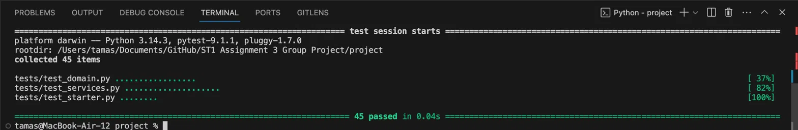
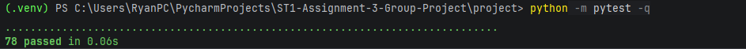

# Stage 6 activities and evidence

Complete this one group record. Link actual issues, diffs, tests and reviews; avoid copying entire histories. Blank fields are intentional. Duplicate rows as needed. Use synthetic data only. Every member records their own meaningful contribution. Do not invent results, reviews or Copilot use.

- Group/tutorial: Group 6 Wednesday 2:30-4:30pm
- Members, GitHub usernames and cohorts: Tamas Szucs = github username = u3318026 = Undergraduate, Ryan Grieves github username = BlackJack2180and Undergraduate, Md Tahmid Ul Islam Tonmoy github username = tahmidtonmoy and Postgraduate
- Repository URL: https://github.com/u3318026/ST1-Assignment-3-Group-Project
- Starting SHA: a4933c1e1f7a40ec38a22d9c9b48fe7493e41ef5

## A Requirement to issue activities

### FR-02 Patient Search

- Title: A patient can be found through ID or name.
- Context: A patient cannot be located without already having an existing record. This is stored by name and ID. A patient can be found by either searching for there specific name or ID.
- Requirement: This system should let us search for a patient by other searching for their name or for their ID number.
- Acceptance criteria: Searching for a ID should only bring up the exact patient. Patients with the same name should have different ID's. Should not be case sensitive. Searching a part of the name should still return the patient. 
- Scope: In scope: Meet requirements, Passes all tests, read only (wont allow you to change data but allows you to read it), Out of scope: Matching mistyped names wioth potential patients, UI changes, Changing or editing patients details.
- Definition of Done: Making sure that all requirements are met, and we are staying in scope.
- Owner: Tamas Szucs
- Actual issue link: [services.py] Line 38-43

### FR-06 Appointment Cancellation with FR-07 retained history

- Title: Cancelling an appointment marks it as cancelled but is still added to the patients history
- Context: When an appointment is cancelled, it should still be added to the patients history because it is important information to know for the practitioner.
- Requirement: FR-06: A appointment can be cancelled, FR-07: A cancelled appointment is still connected with patient history.
- Acceptance criteria: Status of a booking should be changed when cancelled, Cancelled appointment is added to patient history, Once cancelled you cant cancel again, Cancelling one appointment shouldn't cancel another one of the patients appointments.
- Scope: In scope: meet all requirments, Passes all tests, Looking through paitient history must show all cancellations. Out of scope: refunds and other money handling is done seperately, notifications of cancellation, rescheduling, Asking for cancellation reason.
- Definition of Done: meets all requirements, stays within the scope of the task.
- Owner: Tamas Szucs
- Actual issue link: [services.py] Line 151-159

## B Commit quality

| Original example | Strong or Weak | Reason |
|---|---|---|
| changes | weak | way to vague, doesnt explain what was actually done |
| final version | weak | too vague again, doesnt tell you what was done |
| Add patient search by ID | Strong | describes what was done |
| fix stuff | weak | vague again, doesnt tell you what was done |
| Prevent cancellation of completed appointments | Strong | Clearly tells you what was done |

## C Over scoped PR review

A cancellation PR also renames unrelated patient fields, restructures unrelated code and adds a new dependency.

- Scope concerns: The pull request is not related to the task at hand, which would make it larger and harder to reveiw, Should focus only on cancellation.
- Responsibility and architecture concerns: If unrelated things are added, then the code can stop working or affect other parts that were working before.
- Testing and review concerns: Adding extra stuff can increase the chance of having bugs in our code which affects testing and verifying. 
- Changes to remove or separate, with reasons: Remove all unrelated things tha were added, Make them seperate and small so it is easier to review and test.

## D Challenge a weak Copilot review

GitHub Copilot says: "Looks good; tests pass."

- Missing evidence: missing what tests were run, or which file/direcotry, or commit or assert.
- Follow-up review question 1: What exact command did you run?
- Follow-up review question 2: What acceptance criteria was used?
- Follow-up review question 3: After the test does the object stay the same or is it changed by an operator like cancel()?
- Follow-up review question 4: What happened on each failure path?
- Follow-up review question 5: Is anything changed outside of the linked issue?
- Additional questions if useful: n/a

## E Team workflow agreement

| Practice | Team agreement |
|---|---|
| Branch naming | Use descriptive naming schemes |
| Commit message convention | Make sure you are specific in exactly what you did |
| PR size | Make PR's small and on one task/purpose at any time |
| Another-member review requirement | Make sure atleast one other team member is reviewing your pull request before merging |
| Merge rule | Merge only after approval |
| Significant Copilot disclosure rule | Make sure to tell everyone when you are using genertaive AI for code or any other part |

## F Issue and backlog index

Create at least two focused issues. Add a linked practitioner-lookup issue or an explicit supporting criterion with the tutor if needed to cover all three service targets.

| Issue link | Requirement | Owner | Acceptance criteria or precise link | Status |
|---|---|---|---|---|
| [issue 1] | FR-02patient search | Tamas Szucs | FR-02 acceptance criteria, line 31-43 in services.py and tested in test_service | active |
| [issue 2] | FR-06 Appointment cancellation while reataining history | Tamas Szucs | FR-06/07 line 144-159 in serices.py and tested inside the test_services.py | Active |

## G Pull request evidence

Repeat this block per PR. Record actual events, not planned approvals.

- PR link and title: Debug/stage8
- Linked issue and requirement: Stage 8 progress
- Feature branch: Debug/stage8
- Changed behaviour: Completed work for stage 8
- Meaningful commits: Fix F8-01 and update Stage 8 record, commit for f8-01, required commit for f8-02, all test passed sha for D F8-02 diagnosis and repair, refactor sha, Ready for integration (probably)
- Test command, directory and observed result: All passing
- Another-member reviewer: Tamas Szucs
- Human observations recorded before Copilot: Evertything passing, nothing unsatisfactory
- Requirement, responsibilities, test assertions and unrelated-scope checks: Reversed practitioner comparison in has_practitioner_conflict, Practitioner identity mismatch elsewhere in the model (Possible but less likely), find_appointment() intentionally excludes CANCELLED appointments (Most likely), Service-layer lookup logic incorrectly treats "not found" and "cancelled" as the same thing (Possible but secondary), 
- Key feedback: Make sure to meet each of those requirements in testing
- Author response/change and verification: Completed
- Reviewer recheck and approval: Completed
- Merge outcome and SHA: Completed with no issues, sha = 82beacf55cf879ab02fc6ae8d2d49be1941724e6
- Significant Copilot assistance: None
- Linked issue closure: Stage 8 Completion
- Each member updated main: Ryan Grieves
- Integrated verification after merge: sha = 82beacf55cf879ab02fc6ae8d2d49be1941724e6

- PR link and title: Feature/stage9 queries
- Linked issue and requirement: Completion of stage 9
- Feature branch: Feature/stage9 queries
- Changed behaviour: Completing stage 9 work
- Meaningful commits: Ready for new stage 9 branch, Stage 9 Human design, Implement list_practitioner_appointments, Added queries and Test_queries, Added workflow tests, Added Console, Added console workflow tests and scripted runs, Added test_already_sorted_input_gives_a_new_list, Ready for Copilot review, Ready for integration
- Test command, directory and observed result: All tests passing
- Another-member reviewer: Tamas Szucs
- Human observations recorded before Copilot: All passing 
- Requirement, responsibilities, test assertions and unrelated-scope checks:  test_queries, test_workflows
- Key feedback: Make sure all tests are passing, code comments
- Author response/change and verification: Completed
- Reviewer recheck and approval: Completed
- Merge outcome and SHA: Completed with no issues, sha = e2c06c9af1db61c23eae430a0678c5a5fd5dacb5
- Significant Copilot assistance: None
- Linked issue closure: Stage 9 completed
- Each member updated main: Ryan Grieves
- Integrated verification after merge: sha = e2c06c9af1db61c23eae430a0678c5a5fd5dacb5

- PR link and title: Stage 10 appointment rescheduling
- Linked issue and requirement: Appointments are currently unreschedulable, we need to make it so that they can be
- Feature branch: feature/stage10-rescheduling
- Changed behaviour: added a rescheduling mechanism
- Meaningful commits: Add Stage 10 appointment rescheduling
- Test command, directory and observed result: All tests passing
- Another-member reviewer: Ryan Greives and Tamas Szucs
- Human observations recorded before Copilot: Code comments
- Requirement, responsibilities, test assertions and unrelated-scope checks: Everything passing
- Key feedback: code comments
- Author response/change and verification: Completed
- Reviewer recheck and approval: Completed
- Merge outcome and SHA: Completed with no issues, sha = fbad1d2e848ad8ba2b6c457a5c0a0929cf699fbc
- Significant Copilot assistance: None
- Linked issue closure: Reschduling added 
- Each member updated main: Md Tahmid Ul Islam Tonmoy
- Integrated verification after merge: sha = fbad1d2e848ad8ba2b6c457a5c0a0929cf699fbc

- PR link and title: Stage 10: Document review and verification
- Linked issue and requirement: Stage 10 completion
- Feature branch: Stage 10: Document review and verification
- Changed behaviour: Completed work for stage 10
- Meaningful commits: Revise stage10_activities_and_evidence.md for clarity, Document Stage 10 review and verification
- Test command, directory and observed result: All passing
- Another-member reviewer: Tamas Szucs
- Human observations recorded before Copilot: Evertything passing, nothing unsatisfactory
- Requirement, responsibilities, test assertions and unrelated-scope checks: Documentation all filled.
- Key feedback: N/A
- Author response/change and verification: Completed
- Reviewer recheck and approval: Completed
- Merge outcome and SHA: Completed with no issues, sha = 92c4524d06c5db79c21912f97657496b6e622d83
- Significant Copilot assistance: None
- Linked issue closure: Stage 8 Completion
- Each member updated main: Md Tahmid Ul Islam Tonmoy
- Integrated verification after merge: sha = 92c4524d06c5db79c21912f97657496b6e622d83

- PR link and title: Stage 11: SmartCare assurance tests and evidence
- Linked issue and requirement: Completion of stage 11
- Feature branch: Stage 11: SmartCare assurance tests and evidence
- Changed behaviour: Completing stage 11 work
- Meaningful commits: Document Stage 11 assurance evidence, Add Stage 11 SmartCare assurance tests
- Test command, directory and observed result: All tests passing
- Another-member reviewer: Tamas Szucs
- Human observations recorded before Copilot: All passing 
- Requirement, responsibilities, test assertions and unrelated-scope checks: test_non_scheduled_appointment_cannot_be_rescheduled_to_original_time, test_find_patient_rejects_whitespace_only_id
- Key feedback: Make sure all tests are passing, code comments
- Author response/change and verification: Completed
- Reviewer recheck and approval: Completed
- Merge outcome and SHA: Completed with no issues, sha = 94c7f244cf3dd1e995287966516bbb5bc2e7b792
- Significant Copilot assistance: None
- Linked issue closure: Stage 11 completed
- Each member updated main: Md Tahmid Ul Islam Tonmoy
- Integrated verification after merge: sha = 94c7f244cf3dd1e995287966516bbb5bc2e7b792

- PR link and title: Prepare SmartCare Stage 12 release
- Linked issue and requirement: Completion of Stage 12 documentation
- Feature branch: Prepare SmartCare Stage 12 release
- Changed behaviour: Stage 12 completion
- Meaningful commits: Clarify Python setup and record Stage 12 candidate verification, Prepare SmartCare Stage 12 release candidate
- Test command, directory and observed result: All documentaion filled
- Another-member reviewer: Tamas Szucs
- Human observations recorded before Copilot: N/A
- Requirement, responsibilities, test assertions and unrelated-scope checks: All documentation complete
- Key feedback: N/A
- Author response/change and verification: Completed
- Reviewer recheck and approval: Completed
- Merge outcome and SHA: Completed with no issues, sha = 1521b84e4df30e1cc9ea181c8d3087393e4281c2
- Significant Copilot assistance: None
- Linked issue closure: Stage 12 complete
- Each member updated main: Md Tahmid Ul Islam Tonmoy
- Integrated verification after merge: sha = 1521b84e4df30e1cc9ea181c8d3087393e4281c2

## H Copilot collaboration record

Record meaningful required use, not every trivial completion. Repeat per significant interaction.

- Member and task: Ryan Greives, Review Stage 8
- Prompt/purpose and relevant issue/diff: Completing Stage 8
- Summary of output: Reversed practitioner comparison in has_practitioner_conflict, Practitioner identity mismatch elsewhere in the model (Possible but less likely), find_appointment() intentionally excludes CANCELLED appointments (Most likely), Service-layer lookup logic incorrectly treats "not found" and "cancelled" as the same thing (Possible but secondary), 
- Human check against actual code, requirements and tests: Tests are all passing as per requirements
- Decision — Accept / Modify / Reject: Accept
- Reason: Meaningful addition to the enhancement of our code
- Verification/evidence: Check Copilot_review_F8-01.md for more information, all verified

## I Human versus Copilot review comparison

- Human reviewer noticed before consulting Copilot: Something that we noticed when reviewing was that the practitioner id was being stored elswhere in the code away from the immediate function being tested.
- Copilot noticed: Reversed practitioner comparison in has_practitioner_conflict, Practitioner identity mismatch elsewhere in the model (Possible but less likely), find_appointment() intentionally excludes CANCELLED appointments (Most likely), Service-layer lookup logic incorrectly treats "not found" and "cancelled" as the same thing (Possible but secondary),
- Overlap: We didnt have any overlap with the copilot review, we had completely different results from our respective reveiws.
- What did the human reviewer notice that Copilot did not: the practitioner id was being stored elswhere in the code away from the immediate function being tested.
- What did Copilot identify that the human reviewer initially missed: Reversed practitioner comparison in has_practitioner_conflict, We didn't realise this since weren't looking for whether the reversed roles would work, we were just looking for whether the original method would work, if we reverse we should see the same output if it wasnt but since we diddnt realise and copilot did, this is something it noticed that we didnt.
- Unsupported or incorrect Copilot suggestion: None found, since copilot was working off of the requirements built around the requirements of this assessment, it wasnt hallucinating or making judgements outside of the indicated scope.
- Human judgment accepted, modified or rejected, and why: Accepted, because it was meaningful towards our teams success
- Which evidence justified merge approval: Human Evidence justified the merge approval since majority of the review and the everything of the work was human.

## J Contributions

Repeat per member. Include only categories that describe actual work; write not applicable where appropriate. Pairing or mentoring can be supported by a short corroborated note.

- Member: Tamas Szucs
- Implementation: Stage 6-7
- Testing: All tests passed.png
- Review: Working on Main, no review for any PR required. Reviewed by members when working on seperate sections
- Issue refinement: Tests for all working features included for services and domain
- Design and responsibility discussion: Was lead design for implementing parts 6-7, Reveiewed all PR
- Debugging or integration: Was leading part 6-7, had many debuggings during the process of testing, fixed all of those to make sure that its working.
- Documentation or team support: Github reviews and commits.

- Member: Ryan Grieves
- Implementation: Stages 8-9
- Testing: All tests passed.  and 
- Review: Work on stage 8 debug and stage 9 queries branches. Reviewed by Tamas Szucs.
- Issue refinement: Test workflows and Tests queries as well as a few extra tests. [test_queries.py](../project/tests/test_queries.py) [test_workflows.py](../project/tests/test_workflows.py)
- Design and responsibility discussion: Was lead for part 8 and 9. Ran tests for all stages to make usre they all pass.
- Debugging or integration: Was leading part 8 and 9. A few bugs came up such as accidentally writing 'appointments' instead of 'appointment'. All bugs were fixed by the merges of both part 8 and 9.
- Documentation or team support: GitHub reviews and commits.

- Member: Md Tahmid Ul Islam Tonmoy
- Implementation: Led the Stage 10 PG rescheduling change in project/smartcare/domain.py and project/smartcare/services.py. A successful move changes the appointment time while preserving its ID, patient, practitioner and status. Rescheduling stays in the service layer and does not add a console option. Evidence: PR #4 and the Stage 10 evidence record.
- Testing: Added and reviewed focused rescheduling and assurance tests in test_rescheduling.py and test_assurance.py. The assurance cases cover same-time rescheduling attempts for cancelled or completed appointments and whitespace-only patient IDs. For Stage 12, the protected common suite passed 81 tests, and the post-merge PG suite passed 100 tests in 0.09s at 4c5925677be2f9f2fe274f7c1e96eda5dfeb5224. Evidence: PR #6 and Stage 12, Sections C and D.
- Review: Reviewed the Copilot plan and inspected the application and test diffs separately. I asked for the rescheduling test to move an appointment past another booking so it could detect incorrect list ordering. Evidence: Stage 10 evidence record and Stage 12, Section E.
- Issue refinement: Turned the rescheduling requirements into concrete acceptance checks: preserve appointment identity, allow a valid same-time request, reject practitioner conflicts without changing state, free the old slot and show the updated time in lookup and listings. Evidence: Issue #3 and the Stage 10 evidence record.
- Design and responsibility discussion: Kept appointment state rules in the domain and used the service to coordinate lookup and conflict checking through the existing store. Preserved the common workflows and kept persistence outside the release scope. Evidence: project/README.md and Stage 12, Sections E and N.
- Debugging or integration: Diagnosed a fresh setup that picked up Python 3.9.6 instead of Python 3.12.10. I updated the README to call .venv/bin/python directly, then verified dependency installation, both launch modes and the full PG suite in a fresh post-merge worktree. Evidence: Stage 12, Sections F, H and I.
- Documentation or team support: - Updated the root and project READMEs and prepared the Stage 12 release evidence, including setup instructions, tested SHAs, known limitations and viva handover notes. Evidence: PR #7 and stage12/stage12_activities_and_evidence.md.

## K Exit question

Why is a high commit count not necessarily evidence of strong contribution?

Answer: A high commit count doesnt give evidence of strong contribution because the quality of those commits might be very poor. So although on paper it lloks like they are contributing heaps, they could just be changing one small thing, committing and making it look like they are doing heaps of work when they actually arent. You can commit anything after even typing one character, so its not about the quanitity of the commits but raather the quality.

## L Stage 6 formative questions

1. What is version control?

Version control is a way of tracking and controlling different changes to a document or file over time.

2. Why is a feature branch useful?

It is useful because we can rebuild specific things outside of the main branch, which means that we can do more testingt and enhancing without the fear of braking saomething on the main file.

3. What makes a commit a good engineering commit?

A good engineering commit is when it is clearly documented, focuses on purely one task at a time, and make sure that explanations of changes are easy to understand, so future users can understan and if you need to traceback, you can understand as well.

4. What is a pull request?

A pull request is when you divert from the main branch and work on that, and then when you finish you want to merge your work back onto the main branch, which is defined as the pull request.

5. What is the purpose of code review?

The purpose is to make sure that the proposed work is useful and the work doesnt interfere or break existing code. Reviewing the code before it is merged back to main makes sure that the existing code on the main and the new code isn't going to break the system.

6. What does a Git diff show?

A git diff shows the difference between a past version and the new version, The new code will have a green highlighted look, and the removed lines or code will have a red highlight, this makes it easy to see what is added and removed in between different commits.

7. What is a Definition of Done?

The definition of done is meeting the given criteria. This can be based off of quality, tehnical capabilities, but once those criteria are met, it is considered done.

8. What is the appropriate role of GitHub Copilot in pull-request review?

The approprioate use of GitHub Copilot in the pull request review is to use it as a tool for automated review, it shouldnt mean that it is the only one to review it, but it can be the first to review since it can be automated to check it as soon as you do the pull reuqest. It shouldnt be used for comprehensive and deep analysis, but a quick general overview of work and feedback.

9. Why should individual contribution not be judged only by commit count?

A persons commit count shouldnt be related to how much work they put in, if your commit quality is poor, but have a million commits, it looks like you are doing lots of work, but realistically you are arent. Quality is much more preferred over quantity.

10. What is the Stage 6 engineering rule?

The stage 6 engineering rule is to make sure that your commits are meaningful and provide quality changes, rather than sloppy commits that you make over and over, trying to increase your commit count to seem like your doing work, but you actually arent.

## M Completion and handover

- Starting SHA: a4933c1e1f7a40ec38a22d9c9b48fe7493e41ef5
- Final Stage 6 code SHA: 1071174b0296aff1fcb8fecf58b8c1fe7a3b557a
- Test command: N/A
- Working directory: Main
- Observed result: No tests, Everything working, Documentation filled
- PR and another-member reviewer: PR-01, PR-2, PR-03, PR-04, PR-05, PR-06, Reviewers = Tamas Szucs
- Unresolved issue or none: None
- Stage 7 handover status: ready
- Final submitted SHA if later than tested SHA: 9f666f55549448ef184b1218b513dadee2d97198

- [ ] Three Stage 6 service targets completed and checked.
- [ ] Original supplied tests retained and passing.
- [ ] At least two focused issues link requirements and acceptance criteria.
- [ ] Feature work reviewed by another member using the actual diff.
- [ ] Human-first review and required Copilot comparison recorded.
- [ ] Feedback resolved and approval recorded before merge.
- [ ] Everyone pulled main and integrated checks passed.
- [ ] Required activities, quiz responses and contribution notes completed.
- [ ] Only synthetic data included; confidential peer material kept out.
- [ ] Tutor can trace a requirement through issue, code, tests, PR and checkpoint.

Do not write a file's own future commit SHA into that file. Record the tested code SHA first, then commit the evidence; explain the difference when submitting.
