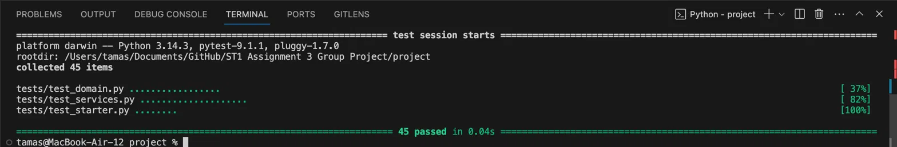
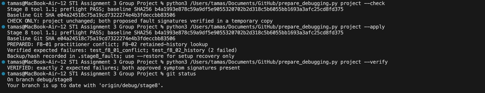

# Stage 8 activities and evidence

UG and PG | One evolving group project | Complete this blank record using the Stage 8 handout.

All Assignment 3 stage materials are provided from the beginning. Complete this stage only after the previous applicable stage has been integrated, verified and recorded. Use this supplied record in stage08/ in your EXISTING repository. Preserve project/, all earlier tests, records and responses. Do not download another starter or copy staff solutions. The Stage 8 preparation utility is supplied or run by teaching staff when Stage 8 begins. Follow your tutor’s controlled workflow and the handout. If temporarily supplied, keep it outside the repository in a sibling Stage_8_Assets/ folder; exclude it from Git and the final submission.

Group/tutorial: Wed 2:30 - 4:30 group 6
Members and UG/PG cohorts: Ryan grieves(UG), Tamas Szucs(UG) and Md Tahmid UI Islam Tonmoy(PG)
Record owner / contribution links for each member: [complete]

Use concise results and accessible artifact links rather than copying entire logs. Keep human-first entries before consulting GitHub Copilot. Link shared evidence once; do not repeat it across sections. No entries below are specimen answers or claimed results.

## A. Tutorial activities

### A.1 Classify all five statements
For each, choose symptom, evidence or hypothesis/opinion, and explain your reason. These are discussion statements, not confirmed diagnoses.
1. Appointment disappears after cancellation.
2. The data-store removal path is probably being called.
3. The failing test shows store.find_appointment('A1') returns None.
4. The service layer is badly designed.
5. Traceback points to smartcare/services.py line 42 in the example.
The example line number is illustrative; inspect the actual line in your run. The removal hypothesis must be tested against the current project, which has no public delete operation.

Response and reason: 
1. Symptom because it describes what the user sees and says nothing about the cause.
2. Hypothesis because it proposes an unconfirmed cause  that is testable.
3. Evidence because it is a hard value that can be repeated by redoing the test.
4. Opinion because "Badly designed" has no testable or measurable benchmark.
5. Evidence because it is from a checkable fact that the output of the code is a traceback to line 42.

### A.2 Build a debugging record
Choose the cancelled-history scenario or a same-practitioner/time booking. Before changing code, record expected behaviour, observed behaviour, minimal reproduction, a hypothesis and evidence to inspect. Use a requirement to justify the expectation. Keep the initial hypothesis even if later evidence disproves it.

Response and reason: The expected behaviour is that after it is cancelled it says stored and can be looked up with the status cancelled. This outcome is from the requirment FR-07(a cancelled appointment is retained in history). The observed behavour is: After cancel_appointment("a1") succeeds, data_store.find_appointment("a1") returns None. appointment_service.find_appointment("a1") then raises LookupError: Appointment not found. A second cancel_appointment("a1") raises LookupError instead of the expected ValueError. To reproduce the test register patient p1 and practitioner pr1. Next book appointment a1 for them at any datetime. Then call cancel_appointment("a1"). Then call find_appointment("a1"). My hypothosis is that find_appointment skips appointments that are cancelled. This would also explain the second failure id cancel_appointment calls find_appointment which leads to a LookupError.

### A.3 Test defect or product defect
A test expects cancelled appointments to be deleted, but FR-07 says history must be retained. What should be changed? Explain why. Also decide whether a test expecting different practitioners at the same time to conflict reflects AC-04.2. Do not assume every failing test is correct.

Response and reason: The requirements are always correct and so the tests should be changed because they conflict with the requirements.

### A.4 Refactoring smell hunt
Consider a hypothetical 70-line AppointmentService method containing duplicate status strings, direct collection manipulation, printing, validation and four nested conditionals. Identify the smells and propose small refactorings that preserve required behaviour. The direct collection work replaces the old storage-specific scenario; use the existing SmartCareDataStore boundary. Do not implement an extra architecture.
Classify these proposed changes as refactoring, repair or feature: rename appt to appointment; extract a repeated conflict helper; add rescheduling; restore retained cancellation lookup; replace a magic status string with the existing enum. Explain the behaviour that must remain unchanged.

Response and reason:Smells in the hypothetical method: Duplicate status strings: to refactor replace with AppointmentStatus enum, Direct collection manipulation: to refactor use add_ and find_ and list_ instead of dictionarys, Printing inside a service: to refactor return the result and let the console print it, Validation is tangled with the logic: to refactor use rely on domain and store’s existing validation, there is 4 nested conditionals: to refactor use guard clauses.     Classifying the proposed changes: rename appt to appointment = Refactoring, extract a repeated conflict helper = Refactoring, add rescheduling = Feature, restore retained cancellation lookup = Repair, replace a magic status string with the existing enum = Refactoring. Behaviours that must stay the same are: Return values because the same appointment object must come back and not a copy, Exceptions because LookupError is required for unknown records and ValueError for invalid inputs, duplicates, conflicts and illegal cancellations, State after failure because a rejected request must leave the stored records unchanged, History because cancelled appointments stay stored and findable and listable, Conflict rule because only the same practitioner booked at the same time should conflict.

### A.5 Traceback and hypothesis ranking
Using one actual failure, identify its exception/assertion, expected and observed values, test line, application call path and supporting requirement. List three plausible causes and rank them by fit with the available evidence. For each cause, name a check that could distinguish it from the others. Explain why a traceback alone does not establish the cause.

Response and reason: 
Failure: test_cancelled_appointment_cant_be_cancelled_again
Exception: LookupError unknown appointment id
Expected: ValueError
Observed: LookupError was raised
Call path: The test calls AppointmentService.cancel_appointment. That method then calls data_store.find_appointment("a1"). It returned none and so a LookupError was raised.
Requirement: FR-06 (a cancelled appointment can't be cancelled again) and FR-07 (cancelled appointments are kept in history).
Possible cause 1: data_store.find_appointment returns None for cancelled appointments. To check call data_store.find_appointment("a1") after the first cancel. If it returns None this is the cause.
Possible cause 2: The cancelled appointment was removed from the store. To check look at list_appointments() after the cancel. If "a1" is still there this is ruled out.
Possible cause 3: A mistake in the test setup or ID like different spelling. To check compare the ID strings used in the setup and the calls.

The traceback isn't enough because it only shows where the error was raised not why.

### A.6 Exit question
Why is changing code immediately after seeing a failure often a poor debugging strategy?

Response and reason: You haven't checked to make sure you have found the right bug in the code if you haven't done tests to check.

Classification responses (1–5, each with reason): See A.1
Tutorial debugging record — expected; observed; reproduction; hypothesis; evidence to inspect: See A.2
Traceback — exception/assertion; expected/observed values; test line; call path; requirement; ranked causes and discriminating checks: See A.5

## B. Stage 7 baseline and safe preparation

- Stage 7 code SHA and requirement baseline: Baseline git SHA = e04a24518c75a19cd7322274e4b3fdeccbb83506, requirements = Smartcare A3 Requirments Baseline 2026, revision 2.
- Baseline test command / working directory / observed result / evidence: "python -m pytest -q" there were 45 tests passed before preparation. Version of pycharm is (Python 3.14.3, pytest 9.1.1). Evidence: 
- Clean preparation SHA if a record-only commit followed Stage 7: Baseline git SHA = e04a24518c75a19cd7322274e4b3fdeccbb83506
- Branch and preparer / how teammates obtained this branch: Prepared by Tamas Szucs (u3318026)
- Downloaded tool version, source SHA256 and --check outcome: stage 8 tool 1.1; preflight PASS; baseline SHA256 b4a1993e878c59a9df5e9055320702b2d318c5b6055bb1693a3afc25cd8fd375
- --apply and --verify output summaries / artifact references: PREPARED F8-01 practitioner conflict and F8-02 retained-history lookup; expected failures test_f8_01_conflict and test_f8_02_history (2 failed); backup and hash recorded in .stage8_faults. --verify: exactly 2 expected failures, both approved symptom signatures present. Evidence: 
- Bounded diff inspected and recovery location (not committed): git diff showed changes to project/smartcare/data_store.py (find_appointment and has_practitioner_conflict) and .gitignore (ignores .stage8_faults/, .stage8-check-*/, .stage8-verify-*/). Recovery backup is in project/.stage8_faults/, which is git-ignored and not committed.
- Prepared faulty-state commit SHA: 7f9ffa0 ("Stage 08 debug setup", u3318026, 28 Oct 2026).
- Preparation or recovery issues and resolution, if any: none
- Initial prepared full-suite command / result / key failures: `python -m pytest -q` from project/ on debug/stage8: 7 failed, 39 passed. Four failures are cancelled-appointment lookups (find_appointment returns None / LookupError after cancelling): test_cancel_appointment, test_cancelled_appointment_is_stored, test_find_cancelled_appointment, test_cancelled_appointment_cant_be_cancelled_again. Three are practitioner conflicts: test_same_practitioner_at_the_same_time_isnt_allowed and test_conflict_rule_and_different_practitioner (DID NOT RAISE ValueError), and test_same_time_different_practitioner_is_allowed (wrongly raised ValueError).

## C. F8-01 diagnosis and repair

- Symptom / observed behaviour: Two bookings for the same practitioner at the same time are both accepted or booking a different practitioner at that same time is wrongly rejected.
- Expected behaviour and requirement: A second booking for the same practitioner at the same datetime is rejected with ValueError and the stored records stay unchanged (FR-05 / AC-04.1). But a different practitioner at the same time is allowed (AC-04.2).
- Minimal synthetic reproduction steps: In a fresh store register patients P1 and P2 and practitioners D1 and D2. Book A1 (P1, D1, 2026-10-01 09:00). Book A2 (P2, D1, 2026-10-01 09:00). Next in another fresh store with A1 booked, book A3 (P2, D2, 2026-10-01 09:00).
- Meaningful failing test path/name and exact relevant failure: project/tests/test_regressions.py and the output is 
============================= test session starts =============================
collecting ... collected 4 items

tests/test_regressions.py::test_f8_01_same_practitioner_same_time_is_rejected FAILED [ 25%]
tests\test_regressions.py:24 (test_f8_01_same_practitioner_same_time_is_rejected)
services = (<smartcare.data_store.SmartCareDataStore object at 0x0000019EECFD1A90>, <smartcare.services.AppointmentService object at 0x0000019EECFD1E80>)

    def test_f8_01_same_practitioner_same_time_is_rejected(services):
        store, appointments = services
        first = appointments.book_appointment('A1', 'P1', 'D1', WHEN)
        before = store.list_appointments()
>       with pytest.raises(ValueError):
             ^^^^^^^^^^^^^^^^^^^^^^^^^
E       Failed: DID NOT RAISE ValueError

tests\test_regressions.py:28: Failed

tests/test_regressions.py::test_f8_01_different_practitioner_same_time_is_allowed FAILED [ 50%]
tests\test_regressions.py:35 (test_f8_01_different_practitioner_same_time_is_allowed)
services = (<smartcare.data_store.SmartCareDataStore object at 0x0000019EECF5FB10>, <smartcare.services.AppointmentService object at 0x0000019EECF5FED0>)

    def test_f8_01_different_practitioner_same_time_is_allowed(services):
        store, appointments = services
        appointments.book_appointment('A1', 'P1', 'D1', WHEN)
>       second = appointments.book_appointment('A2', 'P1', 'D2', WHEN)
                 ^^^^^^^^^^^^^^^^^^^^^^^^^^^^^^^^^^^^^^^^^^^^^^^^^^^^^

tests\test_regressions.py:38: 
_ _ _ _ _ _ _ _ _ _ _ _ _ _ _ _ _ _ _ _ _ _ _ _ _ _ _ _ _ _ _ _ _ _ _ _ _ _ _ _

self = <smartcare.services.AppointmentService object at 0x0000019EECF5FED0>
appointment_id = 'A2', patient_id = 'P1', practitioner_id = 'D2'
date_time = datetime.datetime(2026, 10, 1, 9, 0)

    def book_appointment(
        self,
        appointment_id: str,
        patient_id: str,
        practitioner_id: str,
        date_time: datetime,
    ) -> Appointment:
        """Book registered participant IDs and return the stored
        appointment.
    
        Raise LookupError for absent participants. Raise ValueError for
        invalid values, duplicate appointment IDs or a practitioner
        conflict.
        """
        patient = self.data_store.find_patient(patient_id)
        practitioner = self.data_store.find_practitioner(practitioner_id)
        if patient is None:
            raise LookupError('Patient not found')
        if practitioner is None:
            raise LookupError('Practitioner not found')
        appointment = Appointment(
            appointment_id,
            patient,
            practitioner,
            date_time,
        )
        if self.data_store.find_appointment(
            appointment.appointment_id,
        ) is not None:
            raise ValueError('Appointment ID already exists')
        if self.data_store.has_practitioner_conflict(
            practitioner.practitioner_id,
            date_time,
        ):
>           raise ValueError(
                'Practitioner already has a SCHEDULED appointment at this time',
            )
E           ValueError: Practitioner already has a SCHEDULED appointment at this time

smartcare\services.py:127: ValueError

tests/test_regressions.py::test_f8_02_cancelled_appointment_is_still_found FAILED [ 75%]
tests\test_regressions.py:43 (test_f8_02_cancelled_appointment_is_still_found)
None != <smartcare.domain.Appointment object at 0x0000019EECFCD810>

Expected :<smartcare.domain.Appointment object at 0x0000019EECFCD810>
Actual   :None
<Click to see difference>

services = (<smartcare.data_store.SmartCareDataStore object at 0x0000019EED070410>, <smartcare.services.AppointmentService object at 0x0000019EED071090>)

    def test_f8_02_cancelled_appointment_is_still_found(services):
        store, appointments = services
        booked = appointments.book_appointment('A1', 'P1', 'D1', WHEN)
        cancelled = appointments.cancel_appointment('A1')
        assert cancelled is booked
        assert cancelled.status is AppointmentStatus.CANCELLED
>       assert store.find_appointment('A1') is booked
E       AssertionError: assert None is <smartcare.domain.Appointment object at 0x0000019EECFCD810>
E        +  where None = find_appointment('A1')
E        +    where find_appointment = <smartcare.data_store.SmartCareDataStore object at 0x0000019EED070410>.find_appointment

tests\test_regressions.py:49: AssertionError

tests/test_regressions.py::test_f8_02_repeated_cancellation_is_rejected_without_change FAILED [100%]
tests\test_regressions.py:54 (test_f8_02_repeated_cancellation_is_rejected_without_change)
services = (<smartcare.data_store.SmartCareDataStore object at 0x0000019EECFCE190>, <smartcare.services.AppointmentService object at 0x0000019EECFCE520>)

    def test_f8_02_repeated_cancellation_is_rejected_without_change(services):
        store, appointments = services
        booked = appointments.book_appointment('A1', 'P1', 'D1', WHEN)
        appointments.cancel_appointment('A1')
        with pytest.raises(ValueError):
>           appointments.cancel_appointment('A1')

tests\test_regressions.py:59: 
_ _ _ _ _ _ _ _ _ _ _ _ _ _ _ _ _ _ _ _ _ _ _ _ _ _ _ _ _ _ _ _ _ _ _ _ _ _ _ _

self = <smartcare.services.AppointmentService object at 0x0000019EECFCE520>
appointment_id = 'A1'

    def cancel_appointment(self, appointment_id: str) -> Appointment:
        """Stage 6: cancel through the domain method and retain the
        appointment.
    
        Return the cancelled object. Unknown IDs raise LookupError;
        invalid transitions raise ValueError and leave state unchanged.
        """
        if not isinstance(appointment_id, str) or not appointment_id.strip():
            raise ValueError("Appointment ID Invalid")
    
        if self.data_store.find_appointment(appointment_id) is None:
>           raise LookupError("Unknown appointment ID")
E           LookupError: Unknown appointment ID

smartcare\services.py:155: LookupError

============================== 4 failed in 0.07s ==============================
- Human hypothesis and intended checks: see E, F8-01.
- Supported root cause and inspected code/runtime evidence: In SmartCareDataStore.has_practitioner_conflict the practitioner ID check uses `!=` instead of `==` so only a different practitioner's appointment counts as a conflict. Evidence: After booking A1 with D1 at the test time has_practitioner_conflict('D1', time) returned False and has_practitioner_conflict('D2', time) returned True. 
- Smallest justified fix / diff / why other behaviour is preserved: Changed 'practitioner_id !=` to `practitioner_id ==` in data_store.py has_practitioner_conflict. The excluded-ID, date/time and SCHEDULED-status conditions are unchanged so cancelled and completed appointments still allow a slot and no other method or file was changed.
- Repair SHA / focused verification result: repair SHA = a8368ea  test_f8_01_same_practitioner_same_time_is_rejected and test_f8_01_different_practitioner_same_time_is_allowed now pass. 
Full suite =
_________________________________________________________________________________________ test_f8_02_cancelled_appointment_is_still_found _________________________________________________________________________________________

services = (<smartcare.data_store.SmartCareDataStore object at 0x000001DACD75F110>, <smartcare.services.AppointmentService object at 0x000001DACD908190>)

    def test_f8_02_cancelled_appointment_is_still_found(services):
        store, appointments = services
        booked = appointments.book_appointment('A1', 'P1', 'D1', WHEN)
        cancelled = appointments.cancel_appointment('A1')
        assert cancelled is booked
        assert cancelled.status is AppointmentStatus.CANCELLED
>       assert store.find_appointment('A1') is booked
E       AssertionError: assert None is <smartcare.domain.Appointment object at 0x000001DACD7BDE50>
E        +  where None = find_appointment('A1')
E        +    where find_appointment = <smartcare.data_store.SmartCareDataStore object at 0x000001DACD75F110>.find_appointment

tests\test_regressions.py:49: AssertionError
___________________________________________________________________________________ test_f8_02_repeated_cancellation_is_rejected_without_change ___________________________________________________________________________________

services = (<smartcare.data_store.SmartCareDataStore object at 0x000001DACD7EA2C0>, <smartcare.services.AppointmentService object at 0x000001DACD7EA650>)

    def test_f8_02_repeated_cancellation_is_rejected_without_change(services):
        store, appointments = services
        booked = appointments.book_appointment('A1', 'P1', 'D1', WHEN)
        appointments.cancel_appointment('A1')
        with pytest.raises(ValueError):
>           appointments.cancel_appointment('A1')

tests\test_regressions.py:59: 
_ _ _ _ _ _ _ _ _ _ _ _ _ _ _ _ _ _ _ _ _ _ _ _ _ _ _ _ _ _ _ _ _ _ _ _ _ _ _ _ _ _ _ _ _ _ _ _ _ _ _ _ _ _ _ _ _ _ _ _ _ _ _ _ _ _ _ _ _ _ _ _ _ _ _ _ _ _ _ _ _ _ _ _ _ _ _ _ _ _ _ _ _ _ _ _ _ _ _ _ _ _ _ _ _ _ _ _ _ _ _ _ _ _

self = <smartcare.services.AppointmentService object at 0x000001DACD7EA650>, appointment_id = 'A1'

    def cancel_appointment(self, appointment_id: str) -> Appointment:
        """Stage 6: cancel through the domain method and retain the
        appointment.
    
        Return the cancelled object. Unknown IDs raise LookupError;
        invalid transitions raise ValueError and leave state unchanged.
        """
        if not isinstance(appointment_id, str) or not appointment_id.strip():
            raise ValueError("Appointment ID Invalid")
    
        if self.data_store.find_appointment(appointment_id) is None:
>           raise LookupError("Unknown appointment ID")
E           LookupError: Unknown appointment ID

smartcare\services.py:155: LookupError
_____________________________________________________________________________________________________ test_cancel_appointment _____________________________________________________________________________________________________

    def test_cancel_appointment():
        data_store, _, _, appointment_service, appointment = setup_with_appointment()
        canceled_appointment = appointment_service.cancel_appointment("a1")
        assert canceled_appointment.status == AppointmentStatus.CANCELLED
>       assert data_store.find_appointment("a1").status == AppointmentStatus.CANCELLED
               ^^^^^^^^^^^^^^^^^^^^^^^^^^^^^^^^^^^^^^^^
E       AttributeError: 'NoneType' object has no attribute 'status'

tests\test_services.py:143: AttributeError
______________________________________________________________________________________________ test_cancelled_appointment_is_stored _______________________________________________________________________________________________

    def test_cancelled_appointment_is_stored():
        data_store, _, _, appointment_service, appointment = setup_with_appointment()
        appointment_service.cancel_appointment("a1")
>       assert data_store.find_appointment("a1").status == AppointmentStatus.CANCELLED
               ^^^^^^^^^^^^^^^^^^^^^^^^^^^^^^^^^^^^^^^^
E       AttributeError: 'NoneType' object has no attribute 'status'

tests\test_services.py:149: AttributeError
_________________________________________________________________________________________________ test_find_cancelled_appointment _________________________________________________________________________________________________

    def test_find_cancelled_appointment():
        data_store, _, _, appointment_service, appointment = setup_with_appointment()
        appointment_service.cancel_appointment("a1")
>       found_appointment = appointment_service.find_appointment("a1")
                            ^^^^^^^^^^^^^^^^^^^^^^^^^^^^^^^^^^^^^^^^^^

tests\test_services.py:154: 
_ _ _ _ _ _ _ _ _ _ _ _ _ _ _ _ _ _ _ _ _ _ _ _ _ _ _ _ _ _ _ _ _ _ _ _ _ _ _ _ _ _ _ _ _ _ _ _ _ _ _ _ _ _ _ _ _ _ _ _ _ _ _ _ _ _ _ _ _ _ _ _ _ _ _ _ _ _ _ _ _ _ _ _ _ _ _ _ _ _ _ _ _ _ _ _ _ _ _ _ _ _ _ _ _ _ _ _ _ _ _ _ _ _

self = <smartcare.services.AppointmentService object at 0x000001DACD91D130>, appointment_id = 'a1'

    def find_appointment(self, appointment_id: str) -> Appointment:
        """Return the stored appointment; raise LookupError when absent.
    
        Reject a blank or invalid ID with ValueError; do not create
        records.
        """
        appointment = self.data_store.find_appointment(appointment_id)
        if appointment is None:
>           raise LookupError('Appointment not found')
E           LookupError: Appointment not found

smartcare\services.py:141: LookupError
_______________________________________________________________________________________ test_cancelled_appointment_cant_be_cancelled_again ________________________________________________________________________________________

    def test_cancelled_appointment_cant_be_cancelled_again():
        data_store, _, _, appointment_service, appointment = setup_with_appointment()
        appointment_service.cancel_appointment("a1")
        with pytest.raises(ValueError):
>           appointment_service.cancel_appointment("a1")

tests\test_services.py:162: 
_ _ _ _ _ _ _ _ _ _ _ _ _ _ _ _ _ _ _ _ _ _ _ _ _ _ _ _ _ _ _ _ _ _ _ _ _ _ _ _ _ _ _ _ _ _ _ _ _ _ _ _ _ _ _ _ _ _ _ _ _ _ _ _ _ _ _ _ _ _ _ _ _ _ _ _ _ _ _ _ _ _ _ _ _ _ _ _ _ _ _ _ _ _ _ _ _ _ _ _ _ _ _ _ _ _ _ _ _ _ _ _ _ _

self = <smartcare.services.AppointmentService object at 0x000001DACD9277D0>, appointment_id = 'a1'

    def cancel_appointment(self, appointment_id: str) -> Appointment:
        """Stage 6: cancel through the domain method and retain the
        appointment.
    
        Return the cancelled object. Unknown IDs raise LookupError;
        invalid transitions raise ValueError and leave state unchanged.
        """
        if not isinstance(appointment_id, str) or not appointment_id.strip():
            raise ValueError("Appointment ID Invalid")
    
        if self.data_store.find_appointment(appointment_id) is None:
>           raise LookupError("Unknown appointment ID")
E           LookupError: Unknown appointment ID

smartcare\services.py:155: LookupError
===================================================================================================== short test summary info =====================================================================================================
FAILED tests/test_regressions.py::test_f8_02_cancelled_appointment_is_still_found - AssertionError: assert None is <smartcare.domain.Appointment object at 0x000001DACD7BDE50>
FAILED tests/test_regressions.py::test_f8_02_repeated_cancellation_is_rejected_without_change - LookupError: Unknown appointment ID
FAILED tests/test_services.py::test_cancel_appointment - AttributeError: 'NoneType' object has no attribute 'status'
FAILED tests/test_services.py::test_cancelled_appointment_is_stored - AttributeError: 'NoneType' object has no attribute 'status'
FAILED tests/test_services.py::test_find_cancelled_appointment - LookupError: Appointment not found
FAILED tests/test_services.py::test_cancelled_appointment_cant_be_cancelled_again - LookupError: Unknown appointment ID
6 failed, 44 passed in 0.11s

## D. F8-02 diagnosis and repair

- Symptom / observed behaviour: After an appointment is booked and then cancelled, looking it up returns nothing. data_store.find_appointment('A1') returns None, appointment_service.find_appointment('A1') raises LookupError: Appointment not found, and a second cancel_appointment('A1') raises LookupError: Unknown appointment ID instead of ValueError. The cancel itself succeeds and returns the object with status CANCELLED.
- Expected behaviour and requirement: A cancelled appointment stays stored with status CANCELLED and is still found by store and service lookup, returns the same object and still appears in list_appointments() (FR-06/07, BR-07, FR-08, AC-05.2). Cancelling it again is rejected with ValueError and leaves the state unchanged.
- Minimal synthetic reproduction steps: In a fresh store register patient P1 and practitioner D1. Book A1 (P1, D1, 2026-10-01 09:00). Call cancel_appointment('A1'). Then call data_store.find_appointment('A1').
- Meaningful failing test path/name and exact relevant failure: project/tests/test_regressions.py::test_f8_02_cancelled_appointment_is_still_found (AssertionError: assert None is <Appointment object>) and ::test_f8_02_repeated_cancellation_is_rejected_without_change (LookupError: Unknown appointment ID, services.py line 155). Existing tests showing the same defect: tests/test_services.py::test_cancel_appointment, ::test_cancelled_appointment_is_stored, ::test_find_cancelled_appointment, ::test_cancelled_appointment_cant_be_cancelled_again.
- Human hypothesis and intended checks: see E, F8-02.
- Supported root cause and inspected code/runtime evidence: SmartCareDataStore.find_appointment skips cancelled appointments so it returns None for an appointment that is stored but cancelled. After booking and cancelling A1 list_appointments() contained the appointment while find_appointment('A1') returned None. A search of project/smartcare for del, pop and remove found no matches so a removal path is ruled out.
- Smallest justified fix / diff / why other behaviour is preserved: Removed the condition that excludes cancelled appointments from find_appointment so lookup matches on ID only. The blank-ID ValueError and the None for a valid missing ID are unchanged and no other method or file changed.
- Repair SHA / focused verification result:Sha = a11db4d full suite = 
..................................................                                                                                                                                                                           [100%]
50 passed in 0.04s

## E. Human-first hypotheses

Complete both entries BEFORE Copilot. C/D supply observed/expected/reproduction/test; retain those initial facts and link them here.

### F8-01 human entry
Likely cause and why plausible: The practitioner ID comparison in SmartCareDataStore.has_practitioner_conflict is the wrong way around as it treats a different practitioner as a conflict. It is likely this because it fits the symptoms.
Evidence intended to inspect / competing explanation / discriminating check: Read the practitioner condition in has_practitioner_conflict and compare it with FR-05 / AC-04.1 and AC-04.2. Run has_practitioner_conflict('D1', time) and ('D2', time) after booking with D1; a correct method gives True for D1 and False for D2. Competing explanation: The date/time or SCHEDULED-status condition could be wrong. That would not make a different practitioner wrongly conflict while the same practitioner passes so the opposite results for D1 and D2 tell the two apart.
Member and saved sequence/time or commit showing this preceded consultation: 23df0a4 at 4:10pm on 5/11/26

### F8-02 human entry
Likely cause and why plausible: SmartCareDataStore.find_appointment skips cancelled appointments so it returns None for an appointment that is stored but cancelled. This fits the failing tests, the cancel succeeds then lookup returns None and the service raises LookupError before the domain check that would raise ValueError on a repeated cancel.
Evidence intended to inspect / competing explanation / discriminating check: Read the status condition in find_appointment and compare it with FR-07 / FR-08. After booking and cancelling A1 compare list_appointments() with find_appointment('A1'). If the list contains the appointment but find returns None then lookup is hiding it. A removal path deletes the appointment. A search of project/smartcare for del, pop and remove as well as the fact that A1 is still in the list would rule that out.
Member and saved sequence/time or commit showing this preceded consultation: 0b08c0f at 6:13pm on 6/11/26

## F. GitHub Copilot prompts, findings and human decisions

Use the full handout prompt separately for BOTH defects, after E. Keep each actual prompt or accessible reference; include observed behaviour, expected behaviour, reproduction, failing test, human hypothesis, relevant code, three ranked causes and discriminating checks, with the no-rewrite/no-invented-requirements constraints.

(The code was changed before checking with copilot (i got confused))

### F8-01 Copilot review
Actual prompt / output reference and member: See Copilot_review_F8-01.md by Ryan
1. Ranked suggestion / evidence check / observed evidence / correct, partly correct or wrong / accept, modify or reject with reason: Copilot #1: the practitioner comparison is reversed (!= instead of ==). Check: compare the condition with FR-05 / AC-04.1-04.2 and the two failing tests. Observed: before the repair, same practitioner at the same time was accepted (DID NOT RAISE ValueError) and a different practitioner was rejected; before the fix has_practitioner_conflict('D1', time) returned False and ('D2', time) returned True; after changing != to == both F8-01 tests passed. Correct. Accept.
2. Ranked suggestion / evidence check / observed evidence / correct, partly correct or wrong / accept, modify or reject with reason: Copilot #2: the stored appointment holds the wrong practitioner. Check: look at how the Appointment is built and stored in book_appointment. Observed: the Appointment is built from the practitioner looked up by the requested ID, and the F8-01 tests passed after changing only the comparison, with no storage change. Wrong. Reject. Its suggested check also used store.get_appointment("A1"), which does not exist in this project (the method is find_appointment).
3. Ranked suggestion / evidence check / observed evidence / correct, partly correct or wrong / accept, modify or reject with reason: Copilot #3: a different implementation is being executed than the one shown. Check: search the project for other definitions of has_practitioner_conflict and read the traceback. The traceback pointed at services.py line 127 calling this method; editing this one line changed the results. Wrong. Reject.
Final human conclusion and comparison with initial hypothesis: My hypothesis was correct and lines up with Copilots first hypothesis.

### F8-02 Copilot review
Actual prompt / output reference and member: See Copilot_review_F8-02.md by Ryan
1. Ranked suggestion / evidence check / observed evidence / correct, partly correct or wrong / accept, modify or reject with reason: Copilot #1: find_appointment excludes cancelled appointments. Check: compare list_appointments() with find_appointment('A1') after cancelling. Observed: list_appointments() contained the appointment while find_appointment('A1') returned None; removing the status != "cancelled" condition made both F8-02 tests pass. Correct. Accept. It described the filter as possibly intentional, but FR-07 / FR-08 require cancelled appointments to stay findable, so it is a defect.
2. Ranked suggestion / evidence check / observed evidence / correct, partly correct or wrong / accept, modify or reject with reason: Copilot #2: the service wrongly treats a cancelled appointment as nonexistent, and the store may be meant to find only active appointments. Check: read the store contract in the original docstring and the handout. Observed: the contract is "return the stored appointment or None", with no active-only rule, and the fix was in data_store.py with services.py unchanged. Partly correct, because the service's `is None` check does turn the store's None into LookupError and explains the second-cancel symptom, but that is a consequence, not the cause. Reject as the root cause.
3. Ranked suggestion / evidence check / observed evidence / correct, partly correct or wrong / accept, modify or reject with reason: Copilot #3: the status value or enum mismatches "cancelled". Check: read the failing test traceback. Observed: the assertion cancelled.status is AppointmentStatus.CANCELLED passed before the failing find_appointment line, and AppointmentStatus.CANCELLED has the value 'cancelled'. Wrong. Reject.
Final human conclusion and comparison with initial hypothesis: My hypothesis was correct (because I removed the line of code and it passed all the tests). #2 sounded reasonable but contradicted the store contract.

## G. Failing to passing regression evidence

| Checkpoint | Code SHA or precise diff | Command and working directory | Actual result and artefact reference |
|---|---|---|---|
| F8-01 before repair | 7f9ffa0 | `python -m pytest tests/test_regressions.py -q`, project/  | 4 failed. test_f8_01_same_practitioner_same_time_is_rejected: DID NOT RAISE ValueError. test_f8_01_different_practitioner_same_time_is_allowed: ValueError "Practitioner already has a SCHEDULED appointment at this time". The two F8-02 tests also failed. Output shown in section C. |
| F8-01 after repair | a8368ea | `python -m pytest -q`, project/ | 6 failed, 44 passed. Both F8-01 regression tests pass; all 6 remaining failures are F8-02 (2 in test_regressions.py, 4 in test_services.py). |
| F8-02 before repair | a8368ea | `python -m pytest -q`, project/ | Same run as above. test_f8_02_cancelled_appointment_is_still_found: AssertionError, assert None is <Appointment>. test_f8_02_repeated_cancellation_is_rejected_without_change: LookupError "Unknown appointment ID". |
| F8-02 after repair | a11db4d | `python -m pytest -q`, project/ | 50 passed in 0.04s, including both F8-02 regression tests. |
| Full suite after both repairs, before refactor | a11db4d | `python -m pytest -q`, project/ | 50 passed in 0.04s. |

Explain how the assertions detect each relevant incorrect result and protect previous behaviour: The F8-01 same-practitioner test uses pytest.raises(ValueError), so a double booking that is accepted fails with DID NOT RAISE. It also checks that the stored list is unchanged after the rejection, that A2 was not stored and that A1 is still the same object. The different-practitioner test asserts the second booking succeeds and is stored so a wrongly rejected booking fails. The F8-02 tests assert that cancel returns the same object with status CANCELLED that stores and services lookup return that same object afterwards, that it is still in list_appointments() and that a repeated cancel raises ValueError and leaves the status CANCELLED so a lookup that hides cancelled appointments fails. The earlier tests in test_services.py and test_starter.py were kept and also failed on the same two defects. Running the full suite after each repair shows earlier behaviour still passes.
Unrelated failures investigated / resolution: None. The 7 failures in the first prepared run were all traced to F8-01 (3) or F8-02 (4), and the 6 left after the F8-01 repair were all F8-02.

## H. Refactoring decision and before/after verification

Smell and exact location: Magic status string in project/smartcare/data_store.py, SmartCareDataStore.has_practitioner_conflict: the condition `appointment.status.value == "scheduled"` compares against a hard-coded string, although the existing AppointmentStatus enum (already imported in this file) defines SCHEDULED.
Small proposed structural change / why justified: Replace the condition with `appointment.status is AppointmentStatus.SCHEDULED`. This is justified because the string duplicates the enum's value and would silently stop matching if the value were ever changed or mistyped, whereas the enum member is checked consistently with the rest of the code (for example Appointment.cancel uses `is not AppointmentStatus.SCHEDULED`). It changes how the check is written, not what it returns.
External behaviour to preserve / relevant tests: Has_practitioner_conflict must still return True only for another appointment (a different ID from the excluded one) with the same practitioner ID, the same date/time and status SCHEDULED and False otherwise so cancelled and completed appointments still don't block a slot. Relevant tests: Both F8-01 tests in tests/test_regressions.py, test_same_practitioner_at_the_same_time_isnt_allowed and test_same_time_different_practitioner_is_allowed in tests/test_services.py, test_conflict_rule_and_different_practitioner in tests/test_starter.py and the full suite.
Before result: see G, full passing suite.
Actual change / diff / separate refactor SHA: Replaced `and appointment.status.value == "scheduled"` with `and appointment.status is AppointmentStatus.SCHEDULED):` Refactor Sha = e68be00
Focused and full after-refactor commands / working directory / results / evidence: input: python -m pytest -q output: 
..................................................                                                                                                                                                                          [100%]
50 passed in 0.04s
Result — accepted, revised or rejected / reason / behaviour-preservation conclusion: Accepted the tests passed and give the same results as before. The only difference is that now the enum is more consistant in the code.

## I. Git, human review and integration

Issues for both defects / refactor scope and owners: [complete]
Branch / prepared, repair and refactor checkpoints: [link B/C/D/H]
PR link and another member's reviewer identity: [complete]
Key human feedback, difference from Copilot findings and response/outcome: [complete]
Actual review approval / merge evidence: [complete]
Integrated code SHA and team pull/retest command / working directory / result: [complete]
Evidence-only later SHA / explanation if different: [complete or not applicable]
Each member's substantive contribution and artifact: [complete]

## J. Required reflections

1. Which Copilot diagnosis appeared convincing but lacked evidence? Copilot's #2 for F8-02. It could be true but had no evidence leading to that conclusion. (And it turned out not to be the problem).
2. What evidence changed your group's view? The failing regression tests, the check that list_appointments() still held the cancelled appointment while find_appointment returned None and the opposite D1/D2 results from has_practitioner_conflict. A search for del, pop and remove ruled out a removal path.
3. How did regression tests protect the refactoring? The full suite gave the same result before and after the refactoring. If its result changed than we would know that we had made an error in the refactoring by accidently changing a behavior.

## K. Ten formative questions

1. What should an engineer do before changing code in response to a failure?

Response: Test different causes to narrow down what the cause is.

2. Where should expected behavior come from during debugging?

Response: Expected behavior is the behavior that the code is intended to have with the code that has currently been implemented. (It is the output that is expected from the code).

3. What is a debugging hypothesis?

Response: A hypothesis of what in the code is leading to a bug and how it does so.

4. What is a regression test and why is it retained?

Response: Tests that were ran before a bugfix and are ran after a bugfix to check that the bugfix didn't break anything.

5. What is meant by root cause?

Response: The origin of the problem that when fixed will remove the solve the problem.

6. What is refactoring?

Response: Improving the code without changing its behavior or functionality.

7. What is a swallowed exception?

Response: When a piece of code catches an error during execution and then ignores it.

8. What is a code smell?

Response: It is code that leads to inefficiencies and is hard to maintain.

9. How should GitHub Copilot-generated debugging diagnoses be treated?

Response: They should be checked, scrutinized and only used as advisement.

10. What is the Stage 8 engineering rule?

Response: Diagnose before fixing.

## L. Completion and handover

- [1] Existing project, earlier tests and stage records preserved.
- [1] Passing Stage 7 SHA and safe preparation details recorded.
- [1] Both defects reproduced with meaningful failing tests.
- [1] Both human hypotheses recorded before Copilot; actual suggestions evaluated with evidence.
- [1] Supported causes and minimal repairs explained; focused and full regression results recorded.
- [1] One genuine refactor verified under passing before/after tests.
- [1] Human PR review, feedback resolution and integrated retest recorded.
- [ ] Tutorial, three reflections and ten formative responses complete.
- [ ] Local recovery metadata excluded from submitted source.
- [ ] Same project and full suite ready for Stage 9 after Stage 8 integration, verification and recording.

Verified integrated code SHA / result: see I.
Submitted SHA and evidence-only difference if any: [complete]
Unresolved issues or incomplete checks / owner / next action: [complete]
Handover note: [complete]
