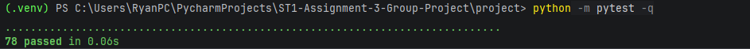

# Stage 9 activities and evidence

Common UG and PG record. All Assignment 3 stage materials are provided from the beginning. Complete this stage only after the previous applicable stage has been integrated, verified and recorded. Use this supplied record in stage09/ in your EXISTING repository. Preserve project/, all earlier tests, records and responses. Do not download another starter or copy staff solutions. Use the Stage 9 handout and Overview/revision 2 baseline. Keep responses concise and link accessible artefacts; do not paste entire logs or private peer ratings.

Group: Wed 2:30 - 4:30 group 6
Members and responsibilities: Ryan grieves(UG), Tamas Szucs(UG) and Md Tahmid UI Islam Tonmoy(PG)
Stage 8 integrated SHA, command, working directory and actual result: `python -m pytest -q` from project/ which outputted
..................................................                                                                                                                                                                          [100%]
50 passed in 0.04s

## A. Tutorial activities

### A1 Session state classification

| Information | Required session/domain or transient state? | Requirement or reason |
|---|---|---|
| Patient identity | session/domain | A booking needs a patient so patient identity must be saved. |
| Appointment history | session/domain | Appointment history is retained and so must be saved. |
| Temporary menu choice | transient state? | It is tempory and dosent need to be saved. |
| Practitioner specialty | session/domain | It is a field of a practitoner and needs to be saved. |
| Debug print output | transient state? | Does not need to be stored in record as it is just a debug output. |
| Appointment status | session/domain | Needs to be saved with appointment as well as retained in history. |

What is intentionally lost on exit? All session data as persistence is retired. (Fr-10)

### A2 Interface and domain data plan

Plan before AI. This replaces schema/key design; no database tables are required.

| Function or component | Explicit inputs and types | Outputs | Responsibility and validation | Domain source / existing constraint |
|---|---|---|---|---|
| appointment_sort_key | appointment: Appointment | tuple[datetime, str] (date_time, appointment_id) | Builds the ordering key. No side effects, no I/O | Appointment.date_time and appointment_id properties |
| select_appointments | appointments: list[Appointment], practitioner_id: str, status: AppointmentStatus None = None | A new list of the same Appointment objects, sorted by the key | Filters by practitioner and optional status, sorts with the named key. Does not mutate the source or check the practitioner is registered. | appointment.practitioner.practitioner_id and status enum |
| Service listing | practitioner_id: str, status: AppointmentStatus None = None | A new list of appointments. | Blank ID gives ValueError and unknown gives LookupError (existing store contract) a non-enum status gives ValueError. known practitioner with no matches returns []; uses the registered practitioner’s ID, then calls the query. | data_store.find_practitioner, data_store.list_appointments, QRY-04. |
| Console | Typed text: menu choice, IDs, names, status text, date/time. | Printed messages | Prompts, parses (parse_date_time), converts status text to an enum (blank means all), calls services, catches ValueError and LookupError and returns to the menu. No domain rules duplicated. | The services, parse_date_time, format_appointment. |

Relate patient ID/name, practitioner ID/name/specialty, and appointment ID/actual participants/date_time/status to the existing contracts: Patient: patient_id is trimmed, non-blank, case-sensitive, read-only after construction and unique in the store (duplicate gives ValueError). Name is validated as non-blank text (Patient in domain.py, add_patient in data_store.py). Practitioner: practitioner_id follows the same rules, name and specialty are each validated as non-blank. Appointment: appointment_id is trimmed, non-blank, read-only and unique. Patient and practitioner are the actual registered Patient and Practitioner objects which add_appointment checks with `is`. Date_time is a naive datetime at minute precision (validate_date_time); status is an AppointmentStatus that starts as SCHEDULED and changes only through the guarded cancel(). The query, service and console must work with these existing contracts and must not add fields.

### A3 Responsibility violations

| Conceptual case | Violation | Correct boundary and reason |
|---|---|---|
| Appointment.cancel reads input | Its not Appointment.cancels job to read input | cancel() should only enforce the status rule and raise ValueError for an illegal transition. |
| Service prints/reads the menu | Service should not print the menu or read what the user types. | Service should only (book, cancel, find) and return the result or an error. |
| Query sorts its source in place | The Query reorders the list so the callers list changes without them knowing. | The query should make a new list and leave the original. |
| Store prints Appointment saved | The data store is printing a message | The store should only keep and find the records. |

### A4 Sorting comparison

For `appointments.sort(key=appointment_sort_key)` and `result = sorted(appointments, key=appointment_sort_key)`, predict source order, return value and result identity. Give a meaningful mutation check: appointments.sort(key=appointment_sort_key): This reorders the original list. It gives back None. result = sorted(appointments, key=appointment_sort_key): It gives back a new sorted list. Mutation check: Before calling the query save the original order and details. After calling it make sure the original list is still in the same order with the same details and that the result is a different list.

Score-example prediction and explanation of passing the named key: If we have 3 people with scores: Harry(5), Barry(17), Jeff(7). Sorted puts items in order of score than the sorted would be (Harry(5), Jeff(7), Barry(17)). Writing key=score_key gives sorted the function so it can use it on every item. Writing score_key() with brackets would run it straight away and give the wrong thing.
### A5 Exit question

Explain cancellation versus deletion, and checks for same-session lookup, all-status listing and SCHEDULED-only exclusion: Cancelling changes the appointment's status to cancelled and then stores it. But deleting would remove the appointment completely so it cant be saved in history.

## B. Human design and contracts

Complete before GitHub Copilot. Record any interface/integrity decision and its reasoning: The query function select_appointments only works on the list it is given and doesn't check if the practitioner exists. Service checks if practitioner exists because Service has the data store. Service only accepts AppointmentStatus or None. Console uses typed text to get enum so a typo is caught before reaching the query. Everything works on the real stored Appointment objects so there is only one version of each appointment.

| Requirement | Input / session data | Operation and responsible component | Expected result or error | Test / evidence |
|---|---|---|---|---|
| QRY-01 only the chosen practitioner | List of appointments for D1 and D2, plus a practitioner ID | select_appointments (queries.py) | Only that practitioner’s appointments come back. | test_query_returns_only_requested_practitioner |
| QRY-02 status filter | Same list, status = None or one of the three statuses | select_appointments | None gives every status. Each status gives only matching ones. No match gives an empty list | test_query_default_all_statuses, test_query_each_status, test_query_no_match_is_empty |
| QRY-03 ordering | Appointments at different times and two at the same time. | select_appointments with appointment_sort_key | Sorted by date/time then appointment ID. Original list is unchanged. | test_query_sorted_by_time_then_id, test_query_source_unchanged |
| QRY-04 service listing | Practitioner ID and status | list_practitioner_appointments (services.py) | Known practitioner with no matches gives []; unknown ID gives LookupError. Blank ID gives ValueError. A status that is not an enum gives ValueError. | test_service_known_empty, test_service_unknown_practitioner, test_service_blank_id, test_service_invalid_status |
| FP-01 same inputs and same result. | Same list and filters called twice. | select_appointments | Both calls give equal results. | test_query_repeat_calls_same_result and reading the code |
| FP-02 new list, same objects. | Empty list, already sorted list and unsorted list. | select_appointments | A different list object each time. The appointments inside are the same objects and also unchanged. | test_query_returns_new_list, test_query_same_objects |
| FP-03 named key | One appointment | appointment_sort_key | Returns (date_time, appointment_id). | test_sort_key_value, test_query_uses_named_key |
| UI-01 full menu workflow. | Typed input following the demo. | run_menu (console.py) calling the services. | Works as the demo shows ending with a normal exit. | scripted input run and a saved output. |
| UI-02 invalid-input recovery | Unknown menu choice, blank or unknown ID, duplicate ID, bad date, bad status and repeated cancel. | run_menu catching ValueError and LookupError | A message is shown, nothing is stored by mistake, and the next valid action works. | scripted input run, saved output and state check. |

Cover QRY-01–04, FP-01–03, UI-01–02 and relevant FR-01–09. Explain empty versus unknown versus invalid, enum conversion, actual object identity, error handling and unchanged state on rejection: Empty versus unknown versus invalid: Empty means the practitioner is real with no matching appointments so the answer is an empty list without an any errors. Unknown means that practitioner ID isn't registered so LookupError. Invalid means the input itself is wrong which is a ValueError. Enum conversion: The console turns the typed text into an AppointmentStatus or None before calling the service and the service doesn't accept plain strings. Object identity: lists hold the same Appointment objects as the store so a test can check `is`. Errors and unchanged state: Errors are raised by the domain, service or store and caught in console. A rejected request must leave stored records as they were.

## C. Implementation and query verification

| Requirement / test ID | Code location | Case and meaningful assertion | Actual result | Evidence link |
|---|---|---|---|---|
| FP-03 / test_sort_key_is_date_time_then_id | queries.py appointment_sort_key | Key equals (date_time, appointment_id) | Passed | see at bottem of C |
| QRY-01 / test_only_requested_practitioner_is_returned | queries.py select_appointments | D1 and D2 appointments given, only D1's come back. | Passed | see at bottem of C |
| QRY-02 / test_default_includes_every_status, test_each_status_filter_returns_only_that_status, test_no_match_gives_empty_list | select_appointments | No status gives all three statuses. Each status gives only its own. No match gives an empty list. | Passed | see at bottem of C |
| QRY-03 / test_sorted_by_time_then_id_for_equal_times | select_appointments | Result IDs are A1, A2, A9. Equal times are broken by ID using cancelled and scheduled appointments at the same time. | Passed | see at bottem of C |
| FP-01 / test_repeated_calls_give_the_same_result | select_appointments | Two calls with the same input give equal results. | Passed | see at bottem of C |
| FP-02 / test_result_is_a_new_list_with_the_same_objects, test_empty_input_gives_a_new_empty_list, test_already_sorted_input_gives_a_new_list | select_appointments | Result is a different list from the source but holds the same Appointment objects. | Passed | see at bottem of C |
| FP-02 / test_source_list_and_objects_are_unchanged | select_appointments | Source order and each appointment's ID. Date/time and status are the same after the call. | Passed | see at bottem of C |
| FP-03 / test_result_order_matches_the_named_key | select_appointments | Result equals sorted(source, key=appointment_sort_key) | Passed | see at bottem of C |
| QRY-04 / test_known_practitioner_with_no_appointments_gives_empty_list | services.py list_practitioner_appointments | Known practitioner, no appointments, empty list and no error. | Passed | see at bottem of C |
| QRY-04 / test_unknown_practitioner_raises_lookup_error, test_blank_practitioner_id_raises_value_error. | list_practitioner_appointments | Unknown ID gives LookupError. Blank ID gives ValueError. | Passed | see at bottem of C |
| QRY-04 / test_text_status_raises_value_error_not_empty_list | list_practitioner_appointments | Status 'scheduled' (text) gives ValueError not an empty list. | Passed | see at bottem of C |
| FR-07 / test_cancelled_appointment_is_kept_found_and_listed | store and services | After cancelling lookup returns the same object. The all-status list and CANCELLED list include it. The SCHEDULED list does not. | Passed | see at bottem of C |

Evidence: 
Input: python -m pytest -q
Output: ..............................................................................                                                                                                                                              [100%]
78 passed in 0.06s
Here is a screenshot of it: 

Include practitioner isolation, every enum status/default all, equal-time ID tie-break, named-key reuse, repeated calls, empty/already-sorted fresh lists, unchanged source order/fields, known-empty/unknown/invalid service cases and retained history.

Purity explanation from code inspection, including absence of hidden state and I/O: select_appointments gets everything from its arguments (the list, the practitioner ID and the status). It iterates through the list, adds the matches to a new list and returns the sorted(... ) of that new list so it never alters the source list. It has no global variables, no print, no input, and it does not modify the store or any service. Appointment_sort_key only accesses two properties of the appointment passed to it.
What the tests do and do not establish: The tests show the correct result for specificaly the cases tested. They do not prove that there is no hidden state or input/output. The tests cant cover every single input and may have missed one that breaks the code somehow or leads to an unexpected outcome.

## D. Integrated console and workflow evidence

| Scenario / acceptance ID | Reproducible inputs / artefact | Expected result | Observed result and state check | Evidence link |
|---|---|---|---|---|
| UI-01 full menu workflow | stage09/evidence/ui01_input.md ran with `Get-Content ..\stage09\evidence\ui01_input.md | python main.py --interactive` (The vertical bar is part of the line that was ran and not signifying that this is the expected output). | Register and find participants; book A1; conflict rejected; A2 with D2 allowed; cancel A1; A1 found as Cancelled; all-status list shows A1; SCHEDULED list is empty; A3 booked in the freed slot; unknown choice handled; normal exit. | Follows expected result | stage09/evidence/ui01_output.md |
| UI-02 invalid-input recovery | stage09/evidence/ui02_input.md ran with `Get-Content ..\stage09\evidence\ui02_input.md | python main.py --interactive` (The vertical bar is part of the line that was ran and not signifying that this is the expected output). | Each bad input (unknown choice, blank ID, unknown ID, duplicate patient, unknown patient in a booking, bad date, impossible date, unknown appointment, repeated cancel, invalid status) shows an Error message and the menu continues. The later BAD-TEXT booking succeeds so the failed one did not reserve the ID. | Follows expected result | stage09/evidence/ui02_output.md |
| Automated service workflow | tests/test_workflows.py (service tests and test_menu_full_workflow, test_menu_recovers_from_bad_input) | Conflict, duplicate and unknown-participant rejections leave stored records unchanged; different practitioner allowed; cancel keeps history; repeated cancel rejected; freed slot can be rebooked. | They all passed. 78 passed in 0.06s |  |

Include registration/find, booking, conflict rejection, different-practitioner booking, cancellation, retrieval, listing/filtering, freed slot and exit; duplicate/unknown/blank IDs, malformed/impossible date, invalid status, unknown choice and repeated cancellation. Identify before/after state and subsequent successful action.

## E. GitHub Copilot review and human decisions

Human design completed before AI: <!-- reference -->
Actual prompt/context supplied: <!-- paste or accessible reference -->
Actual response: <!-- accessible reference -->

| AI finding | Code/test evidence | Severity | Accept/Modify/Reject and reason | Change or no change | Actual verification |
|---|---|---|---|---|---|
| | | | | | |

Responsibility check: explain how domain invariants, shared-store collections, service coordination, pure queries and console effects remain separate: <!-- response -->

## F. Required reflections

1. Which integration concern was architectural rather than a filtering/sorting detail? <!-- response -->
2. Which Copilot suggestion did you reject as over-engineering, and why? <!-- response -->
3. How did you prove cancelled appointments remain retrievable and listable in the same session? <!-- response -->

## G. Ten formative answers

1. What makes select_appointments pure, and what side effect breaks purity? select_appointments is pure since it takes everything it needs through its parameters, returns a result and doesn't change anything else. Any change that happens outside it breaks the purity: sorting the original list printing reading typed input, or touching a global variable.
2. Which explicit inputs are needed, and why avoid a global store? It needs the list of appointments, the practitioner id and the status (or none). We don't want a global store, as then the result depends on hidden data and it becomes harder to test and could change without caller knowing.
3. How can a new list reuse Appointment objects safely? The new list can hold the same appointment objects as the old one (not copies) so long as the function only reads them and never modifies them. The new list can then be sorted or filtered without touching the old one.
4. Why use a named key, and what breaks equal-time ties? A named key is one function that states the way appointments are ordered so the query and the tests all use the same rule. The key is date/time then appointment ID. If the ID were not included appointment at the same time would simply remain in whichever order they arrived in so could change.
5. How do default and explicit status filters differ? The default (no status) shows every appointment including cancelled and completed ones. An explicit status shows only the appointments with that status.
6. How do empty, unknown practitioner and invalid filter cases differ? Empty is the case where a real practitioner exists but has no matching appointments and so you are returned an empty list and no error. Unknown is the case where the practitioner ID does not exist in the system and you are returned a LookupError. Invalid is the case where the input itself is wrong, for example a blank ID, or a status which is typed into the system in text not an AppointmentStatus and so you get back a ValueError.
7. Which console errors recover, and how is unchanged state checked? The console catches and recovers from ValueError and LookupError for example, bad date, unknown, or duplicate ID, booking conflict, bad status, repeated cancel or an unknown menu choice. To see if anything has changed, list or find the records before and after, look at the failed id wasn't stored and look at the next valid action.
8. What is data integrity for registered participants, conflicts and history? Data integrity means the records stay correct and consistent. An appointment must use the real registered patient and practitioner. A practitioner can't be double-booked at the same time and cancelled appointments stay stored so history isn't lost.
9. What is Copilot's review role, and who verifies findings? Copilot is an advisor that suggests things to check or do but everything it does must be verified by the human by checking it against the code, requirements or tests.
10. How do pure functions and OOP responsibilities work together? Pure functions handle lists. The objects each do one job. Domain objects keep the rules, the store keeps the records and the services and console talk to the user. The console dosent decide the rules for talking to the user it just calls services.

## H. Review, completion and common handover

Issues and bounded branches: <!-- links -->
PR/diff and another-member human reviewer: <!-- actual links/name -->
Review responses and Copilot comparison: <!-- links -->
Integrated common Stage 9 SHA: <!-- complete -->
Full regression command, working directory, actual count/result and evidence: <!-- complete -->
README run instructions and scope/limitations: <!-- link -->
Unresolved issues and support/action: <!-- complete -->
UG common candidate / PG future branch plan: <!-- complete -->

- [ ] Query contracts, purity, new lists and named-key ordering verified.
- [ ] Service empty/unknown/invalid cases and cancellation history verified.
- [ ] Every console command and invalid-input recovery demonstrated.
- [ ] Query and workflow tests plus all previous tests pass; actual evidence linked.
- [ ] Human design, Copilot critique, review and integration recorded honestly.
- [ ] Reflections and ten formative responses completed.
- [ ] README updated; earlier code/tests/records preserved.
- [ ] Common SHA protected for UG Stage 12; PG Stage 10/11 work deferred until approved.

No persistence, rescheduling or assurance implementation is part of Stage 9. UG: 6→7→8→9→12. PG: 6→7→8→9→10→11→12. Mixed groups keep one repository and protect the common candidate.
